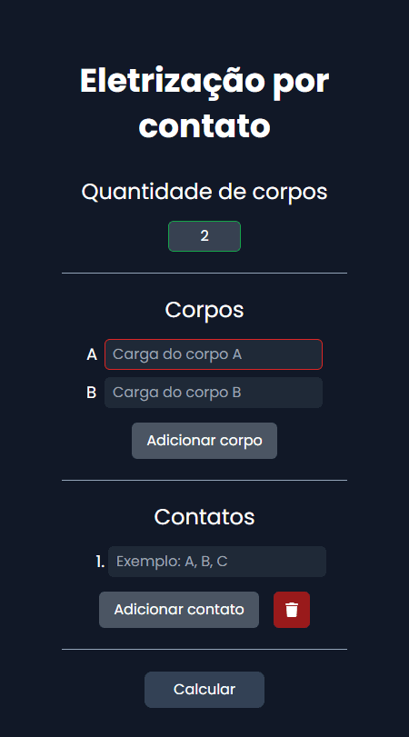
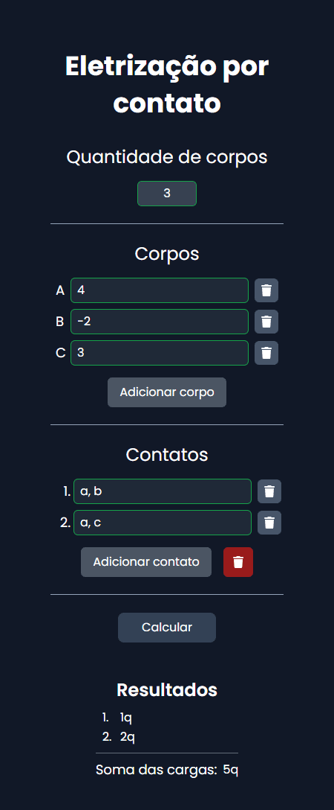

# Contact Electrification

> **Language / Idioma:** **English** | [Português (Brasil)](README.pt-BR.md)
>
> *Se você prefere ler esta documentação em português, [clique aqui](README.pt-BR.md).*

<div align="center">
	<a href="https://contact-electrification.vercel.app">
		
	</a>
	<h3>Contact Electrification Calculator</h3>
	<p>
		A Next.js website that calculates the charge of two or more bodies after<br>
		a sequence of contacts between them, showing every result as an exact fraction.
	</p>
</div>

<br>

<p align="center">
	
	
	
	
	
	
</p>

## Table of Contents
- [Contact Electrification](#contact-electrification)
  - [Table of Contents](#table-of-contents)
  - [About the Project](#about-the-project)
    - [How It Works](#how-it-works)
  - [Key Features](#key-features)
  - [Tech Stack](#tech-stack)
  - [Getting Started](#getting-started)
    - [Prerequisites](#prerequisites)
    - [Installation](#installation)
    - [Running the Application](#running-the-application)
    - [Tests \& Linting](#tests--linting)
  - [Screenshots](#screenshots)
  - [License](#license)

## About the Project
This website calculates contact electrification between two or more bodies. You choose how many bodies take part (from 2 to 26, labeled from A to Z), the initial charge of each one and the sequence of contacts between them. The result lists the charge after each contact, as well as the total charge.

### How It Works
When identical conducting bodies touch each other, their total charge is shared equally among them. Each contact lists the bodies that touch (for example, `A, B, C`), and contacts are applied in order, so later contacts use the charges left by the previous ones. The total charge never changes, which makes it a handy check for the results.

Charges accept integers, decimals and scientific notation, with an optional `q` suffix (`3`, `-1.5q`, `2e-3`).

## Key Features
- **Exact results**: every charge is a rational number, so `1/3` stays `1/3` instead of becoming `0.333…`.
- **Native math rendering**: fractions are rendered with MathML, without any extra library.
- **Input validation**: invalid charges and contacts are reported with a message, and the field with the problem receives focus.
- **Keyboard-friendly lists**: `Enter` moves to the next input (creating one at the end), and `Shift+Enter` moves back.
- **Translations**: English and Brazilian Portuguese, selected by the route (`/en` and `/pt-BR`).
- **Accessible and responsive UI**: labeled fields, results announced to screen readers and a layout that works on phones.

## Tech Stack
- **[Next.js 16](https://nextjs.org/)** (App Router, Cache Components): static rendering of both locales.
- **[React 19](https://react.dev/)**: component-driven UI.
- **[TypeScript](https://www.typescriptlang.org/)**: static typing, including the translation keys.
- **[Tailwind CSS 4](https://tailwindcss.com/)**: utility-first styling.
- **[next-intl](https://next-intl.dev/)**: route-based internationalization.
- **[Fraction.js](https://github.com/rawify/Fraction.js)**: exact rational arithmetic.
- **[React Toastify](https://fkhadra.github.io/react-toastify/)**: validation feedback.
- **[Jest](https://jestjs.io/) + [Testing Library](https://testing-library.com/)**: unit and component tests.

## Getting Started

### Prerequisites
- **Node.js** `^22.18`, `^23.5` or `>=24`
- **[pnpm](https://pnpm.io/)** `12`

### Installation
```bash
git clone https://github.com/Alphka/Contact-Electrification.git
cd Contact-Electrification
pnpm install
```

### Running the Application
* **Development mode** (Turbopack, hot reload):
  ```bash
  pnpm dev
  ```
  Open [http://localhost:3000](http://localhost:3000).

* **Production build & execution:**
  ```bash
  pnpm build
  pnpm start
  ```

### Tests & Linting
```bash
pnpm test
pnpm lint
pnpm tsc
```

The same checks run on GitHub Actions for every push to `main` and every pull request.

## Screenshots

<p align="center">
	<picture>
		<source type="image/webp" srcset=".github/screenshot.webp">
		
	</picture>
</p>

<p align="center">
	<picture>
		<source type="image/webp" srcset=".github/screenshot-1.webp">
		
	</picture>
</p>

## License
[ISC](LICENSE.md) © 2022 Kayo Souza
